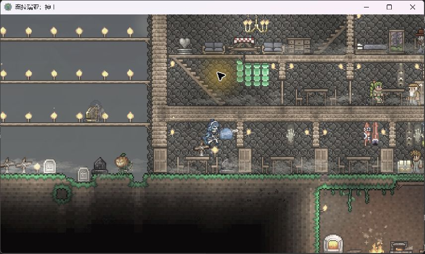
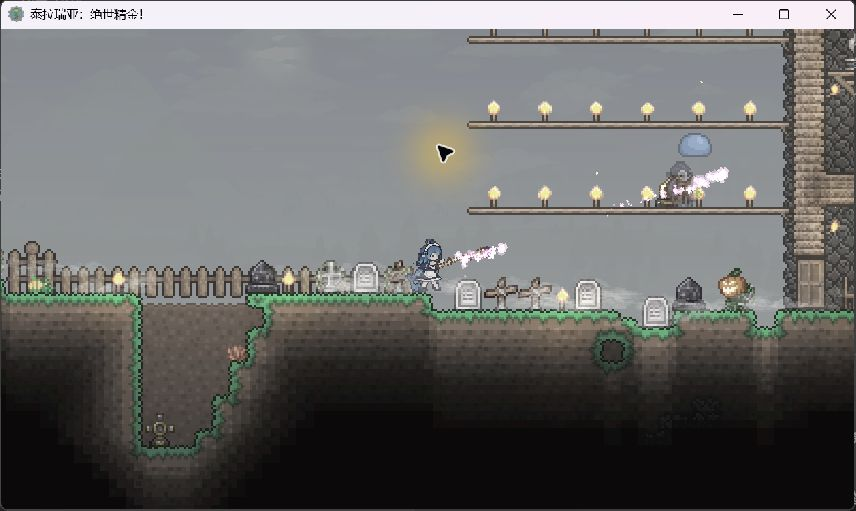
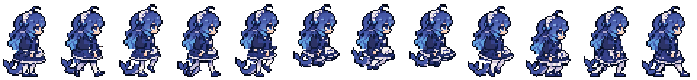

# 《泰拉瑞亚》单人开荒，喊一声「小鲸鱼，跟随」


*小鲸鱼封面插图，角色造型取自模组里的像素皮肤。*

刚把工作台摆好，门外就蹦来了两只史莱姆。手上还拿着木墙，先在聊天框敲一句「小鲸鱼，攻击」，让她迎上去。等地上散了一圈掉落，再叫她「拾取」。下一趟下矿，出门时记得喊她跟上。

这是 **Terraria AI Teammate · 小鲸鱼**，一个给单人世界加队友的模组。小鲸鱼有自己的背包、武器和装备槽。跟随、战斗、拾取这些基础动作可以离线玩，接入大语言模型后，也能在原来的游戏聊天框里跟她商量下一步。

**当前版本 v0.2.12 协作者测试版** · 单人 Terraria 1.4.4.9 · tModLoader 2026.09.3.1

[下载 TerrariaAITeammate.tmod](https://github.com/wfz2006/TerrariaAITeammate/releases/download/v0.2.12-test.1/TerrariaAITeammate.tmod) · [发行说明](https://github.com/wfz2006/TerrariaAITeammate/releases/tag/v0.2.12-test.1) · [安装与上手](#安装与上手)

## 先叫她一起出门

**下洞跟队，回家过门。** 走到房子另一头，可以叫她「过来」。要自己下去探路，就说「停下」，让她先留在原地。她会按游戏里的通路找你，遇到门、楼梯和多层平台时，可以看看她会选哪边绕。

**刷怪有人接手，打完还能捡。** 面板上的「攻击」会让小鲸鱼找附近的敌怪。试试把一把顺手的剑或法杖放进她的背包，再给她换上。打完用「拾取」扫一遍地面。你可以在她的背包里确认哪些掉落捡回来了。

| 小鲸鱼在屋内用剑接近史莱姆 | 小鲸鱼在地面用法杖发出弹道 |
| --- | --- |
|  |  |

*上图为开发期间的游戏实机画面。*

**有多余的装备，就分给她一件。** 打开小鲸鱼的背包可以管理武器、盔甲和饰品。穿上支持显示的装备后，头盔、护甲和饰品会出现在她身上。她自己的蓝发、裙摆和鲨鱼尾巴也有随动作切换的像素帧。



## 想交代一串活，直接在聊天框说

配好模型后，还是按游戏里平时聊天的方式输入。默认以「小鲸鱼，」或 `@小鲸鱼` 开头，她就会接这句话。可以先用一条短指令看看她怎么理解你的要求。

> 小鲸鱼，先看看你背包里有没有做火把的材料。告诉我还缺什么，先别出发。

等她查完背包，再试着交代一件有明确结果的事。

> 小鲸鱼，找木材和凝胶，做 10 根火把，带着成品回到我身边。如果找不到材料，告诉我卡在哪一步。

她会结合背包、附近地形和上一步的执行结果，决定先查询、移动、采集还是合成。采集、合成、带回这样的长任务仍在测试。想帮忙试难一点的，可以观察她走错岔路、材料不足或玩家走开以后，会不会重新判断。

## 安装与上手

1. 从上方下载 `TerrariaAITeammate.tmod`，放入 tModLoader 的本地 `Mods` 文件夹。
2. 在 tModLoader 启用模组并重新加载，再进一个单人世界。
3. 输入 `/ai spawn` 召唤小鲸鱼。按 **O**、点右下角的「小鲸鱼」，或输入 `/ai panel` 打开面板。

想换个称呼，打开 **队友面板 → 设置 → 队友名字**。保存后角色和面板会显示新名字，聊天里也可以用新名字点名。

| 你想让她做什么 | 游戏聊天框输入 |
| --- | --- |
| 跟你走 | `/ai follow` |
| 到你现在的位置 | `/ai come` |
| 停下当前行动 | `/ai stop` |
| 攻击附近敌怪 | `/ai attack` |
| 捡地上的掉落 | `/ai pickup` |
| 穿戴她背包里的指定物品 | `/ai equip <物品名>` |

想用自然语言规划，在 **小鲸鱼 → 设置** 填写自己的 API 地址、模型和 API Key。默认模型是 `deepseek-flash`。想先熟悉离线玩法，开一个单人档，召唤小鲸鱼后试试跟随和攻击就行。

## 试出 Bug，给我留个现场

最想收到的是能复现的情况。比如你在二楼喊她过来，她从哪扇门开始绕、最后停在哪一级平台。可以先在 **小鲸鱼 → 测试记录** 开启记录，碰到问题时点「标记 Bug」，或直接在聊天框输入 `/ai bug <描述>`。

随时点 **导出 JSON**，文件会存到 tModLoader 存档目录里的 `AITeammate/Diagnostics/Exports`。自动记录默认关闭，开启后会保存任务结果、寻路错误、模型 token 与缓存计数等诊断数据。把导出文件和复现步骤手动发给维护者，就能对着同一段过程查问题。[GitHub Issues](https://github.com/wfz2006/TerrariaAITeammate/issues)

<details>
<summary>从源码构建</summary>

安装 .NET 8 SDK 和 tModLoader，用 `tModLoaderPath` 指向包含 `tMLMod.targets` 的安装目录。

```text
dotnet build AITeammate.csproj -c Release -p:BuildMod=false -p:tModLoaderPath="<tModLoader 安装目录>"
```

也可以把源码放到 tModLoader 的 `ModSources/TerrariaAITeammate`，使用游戏内的模组源码菜单打包。

</details>

<details>
<summary>English quick start</summary>

小鲸鱼 is a companion mod for single-player Terraria. She can follow, fight, pick up items and wear equipment offline. Connect an LLM for natural-language requests and multi-step tasks.

1. Download `TerrariaAITeammate.tmod` from the release above. Place it in the local Mods folder for tModLoader 2026.09.3.1, enable it and reload.
2. Enter a single-player world and type `/ai spawn`. Press **O** or use `/ai panel` to open the companion panel. Set **Teammate name** in Settings, then use that name to address the teammate in chat. The default is `@小鲸鱼`.
3. Open **Test diagnostics** to record locally, mark a bug or export JSON. `/ai bug <description>` adds a note. Send the export and reproduction steps to the maintainer.

</details>
